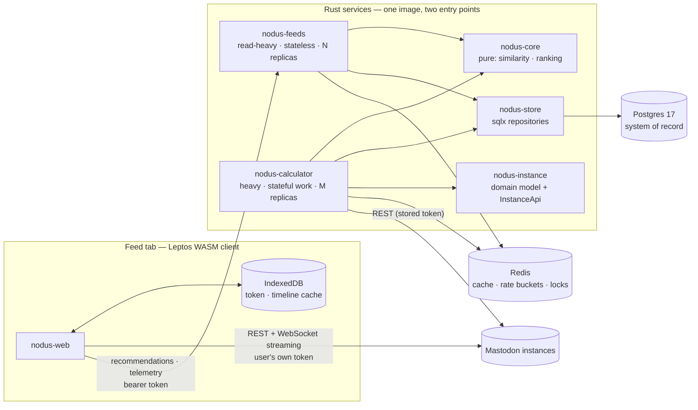

# 02 — Architecture

Status: draft · Last revised: 2026-11-06 (revision 5: two deployables — a light
user-facing feeds service and a separate calculator)

## Shape

A **client that talks to Mastodon directly**, a **light user-facing service that
serves recommendations**, and a **separate calculator that does the expensive
work**. One Postgres, one Redis. No message broker. Three repositories.



Four rules make this coherent:

1. **The browser is the client's data plane.** Timelines, threads, compose,
   notifications and streaming go straight from the WASM app to the instance the
   user belongs to. Our API is not a proxy — it would double our rate-limit
   exposure and add latency for no benefit.
2. **The feeds service is the discovery plane.** It owns the feed endpoint,
   telemetry intake and consent. It never serves a home timeline, and it never
   runs a computation that grows with the graph.
3. **The calculator does everything that grows.** Graph sync, similarity,
   affinity, candidate materialisation, model fitting, retention. It is the only
   process that crawls instances.
4. **They never call each other.** The seam is the database, not RPC. Either can
   be down without breaking the other: feeds serves a degraded snapshot,
   calculator catches up on its backlog.

## Why two deployables

The two workloads fail differently, scale differently and are attacked
differently:

| | `nodus-feeds` | `nodus-calculator` |
| --- | --- | --- |
| Request shape | one request in, one JSON out | long jobs, minutes to hours |
| Work per request | bounded: one indexed read + O(500) arithmetic | unbounded: grows with accounts, edges, users |
| Scaling signal | RPS, p95 latency | queue depth, job age per tier |
| Failure it causes | none — bad replica is replaced by HPA | queues the backlog; recovers on restart |
| Blast radius of a bug | wrong page for one user | wrong scores for everyone, until recomputed |
| State | none (tokens live in Postgres) | leases, per-host budget counters |
| Concurrency | hundreds | tens, capped by instance rate limits |

A single process would share a pool, a runtime and a memory limit between them,
so a similarity recompute would steal connection capacity and CPU from feed
requests — exactly the two failures this split exists to prevent: **computation
overload** and **database overload**.

## Write ownership

One writer per table is what keeps the two services from racing each other.
Feeds is deliberately **read-only for derived data**:

| Table | Feeds | Calculator |
| --- | --- | --- |
| `instance` | upsert (on token intake) | upsert |
| `app_user` | upsert, consent, soft delete | read |
| `account` | read | write |
| `follow_edge`, `engagement_edge` | read | write |
| `status` | read | write |
| `user_similarity`, `account_affinity` | **read only** | write |
| `recommendation_item` | write (the snapshot it served) | prune |
| `interaction_event` | write (telemetry) | read, prune |
| `job` | enqueue | claim, complete, fail |
| `model_version` | read | write |

The database enforces it: two roles, `nodus_feeds` and `nodus_calculator`, with
`GRANT`s matching this table. A feeds query that tries to write `account_affinity`
fails at the database, not in review.

The one exception is `recommendation_item`: the service that decided what to show
records what it showed, because telemetry refers to `item_id`s it minted.

## The seam

**Postgres is the system of record.** Everything durable crosses between the
services through it: derived tables, the job queue (`SELECT … FOR UPDATE SKIP
LOCKED`), and the consent flags on `app_user`. There is no RPC, no event bus, no
shared crate that the two processes use to call each other. That is a deliberate
trade: a queue push of 100 ms is worth the ability to restart either service
without a coordinated protocol.

**Redis is for things that may be lost.** Nothing in Redis is a source of truth:

| Use | Key | Loss behaviour |
| --- | --- | --- |
| Token verification cache (10 min TTL) | `verify:<sha256(token)>` | one extra Mastodon request per feed call, until re-warmed |
| Feed snapshot cache (60 s) | `feed:<user_id>:<cursor>` | rebuild from `account_affinity` |
| Per-host sync budget | `budget:<host>` | calculator falls back to the persisted `instance` counters, slightly conservative |
| "One global recompute at a time" | `lock:recompute` | after the TTL, a second calculator replica starts a duplicate recompute — wasteful, not wrong |
| Rate limit for unauthenticated routes | `rl:<route>:<ip>` | limits reset; acceptable |

Without `REDIS_URL` the services fall back to in-process maps. That is fine for
local development and for a single replica, and it is **refused at startup when
`REPLICAS > 1` is misconfigured**, because per-replica rate limits would
multiply the real request rate.

## Overload controls

The point of the split is that each service can be protected independently.

**Feeds — bounded per request.**

- One query per request, covered by an index, plus O(500) arithmetic in `core`.
  No query runs inside a loop over candidates.
- Pool: `FEEDS_DB_MAX_CONNECTIONS` (default 10), role `nodus_feeds`,
  `application_name = 'nodus-feeds'` so Postgres can attribute load.
- `statement_timeout = 1s` on the feeds role, `idle_in_transaction_session_timeout
  = 5s`. A slow query degrades one request instead of filling the pool.
- The feed snapshot is written as one insert; the ranking result is cached in
  Redis for 60 s so a client that re-renders does not re-rank.
- HPA on RPS and p95 latency, `minReplicas: 2`, `maxReplicas: 20`, with a
  PodDisruptionBudget of one.

**Calculator — bounded per job.**

- Pool: `CALC_DB_MAX_CONNECTIONS` (default 4), role `nodus_calculator`,
  `statement_timeout = 30s`, and no interactive transaction that spans a network
  call to an instance (fetch outside the transaction, then write).
- Jobs are leased with `FOR UPDATE SKIP LOCKED` and a lease deadline; a replica
  that dies mid-job is reaped by `reap_expired_leases` after 10 minutes.
- Per-host request budget: `SYNC_MAX_RPS_PER_HOST` and `SYNC_BUDGET_FRACTION` of
  the instance's reported remaining budget, tracked in Redis so that N replicas
  share one budget instead of each spending it.
- Global recomputes (similarity, affinity, model fit) take the `lock:recompute`
  Redis lock, so exactly one replica works on the whole graph; the others keep
  serving their own cheap tiers.
- HPA on queue depth via KEDA (or a CronJob-scaled deployment), `minReplicas: 1`,
  `maxReplicas: 8`.

**Postgres — bounded by construction.**

- Two roles with different rights (above) and different pools.
- Every table that grows has a retention job in the calculator, batched with
  `LIMIT` so a delete never holds a long lock (`store::retention`).
- Writes from the calculator are batch `INSERT … SELECT`/`UNNEST`, never per-row
  round trips; `COPY` where the volume justifies it.
- The only hot write path from the user side is `interaction_event`, which is
  append-only and pruned at 90 days.
- Read replicas are a possible later step; the feeds role already only reads
  derived tables, so routing it is a connection-string change. Not needed at the
  scale in [01-vision.md](01-vision.md).

## Repositories

```text
nodus/
├── sdk/          nodus-shared, nodus-instance, nodus-protocol, nodus-sdk   (git repo)
├── recommender/  core, store, feeds, calculator            (git repo)
│   └── docs/     this document set
└── web/          the Leptos client                          (git repo)
    └── docs/     the client document set
```

The three projects are submodules of one superproject. `recommender` and `web`
both depend on the SDK crates, and both are compiled for different targets
(native vs `wasm32`). Three consequences worth stating, because they are the
reason this split has costs:

- **The SDK owns client state, not just types.** Session, timelines, feed,
  streaming status and cache policy live in `nodus-sdk`; the web client
  renders that state and dispatches commands. Without this, pagination and
  cache-expiry rules would exist twice (browser and calculator) and drift.
- **Pinned by gitlink, consumed by path.** The superproject records the exact
  commit of each submodule, and consumers depend on `path = "../sdk/crates/…"`.
  One commit therefore describes a known-good combination, and a cross-project
  change compiles before anything is pushed. Git-URL dependencies were rejected:
  they duplicate the sources, add a second source of pinning, and block the
  edit-and-build loop.
- **Additive-only within a minor.** The two sides deploy independently, so a
  change that removes or renames a field is a major bump and a coordinated
  release. See [03-contract.md](../../sdk/docs/03-contract.md).

The SDK repository also runs a CI job that checks out `recommender@main` and
`web@main` against the proposed SDK commit: it is the only place where both
consumers are guaranteed to compile together.

The devcontainer at the repository root mounts all three projects into one
container, which is the supported local setup.

## Crates

| Crate | Kind | Responsibility |
| --- | --- | --- |
| `nodus-core` | lib, pure, wasm-safe | domain types, similarity, candidate generation, scoring, diversity, reason formatting. No I/O, no clock, no async. |
| `nodus-shared` | lib, wasm-safe (sdk) | wire DTOs shared by API and client (serde). The single source of truth for the HTTP contract. |
| `nodus-protocol` | lib (sdk) | The Nodus extensions on top of Mastodon: `/api/v1/meta` capabilities, typed event subscriptions, batch requests. Deliberately separate from `nodus-instance`, so the compatibility crate cannot grow a Nodus-only assumption. |
| `nodus-instance` | lib, native + wasm (sdk) | Mastodon domain model plus `InstanceApi` (the operations as a trait). Transports are feature-gated: `reqwest` on native, `gloo-net`/`web-sys` on wasm. One surface, no duplicated endpoint definitions. |
| `nodus-sdk` | lib, wasm-safe (sdk) | client state machine: `AppState`, `Command`, `Sdk<I, D, P, C>` over four ports (`InstanceApi`, `Discovery`, `Persistence`, `Clock`). No framework dependency, no I/O in `dispatch`. |
| `nodus-store` | lib | the only crate that writes SQL: sqlx repositories, migrations. |
| `nodus-feeds` | bin | axum HTTP: feed, telemetry, token intake, health/metrics. Read-only on derived data. |
| `nodus-calculator` | bin | the job loop: sync, expansion, similarity, affinity, candidate materialisation, model fitting, retention. |
| `nodus-web` | wasm bin (web) | the Leptos client (the product UI). |

`core`, `shared` and `instance` compile to `wasm32-unknown-unknown`; if one of
them starts needing tokio or sqlx, something is in the wrong crate.

`feeds` and `calculator` are two binaries of one workspace and one container
image, started with different arguments. They share `core` and `store`, and
nothing else — no shared in-process cache, no shared static, no shared runtime
state. The image tag is the deployment unit; the entry point is the role.

## Token and identity model

The client authenticates to Mastodon itself: dynamic client registration
(`POST /api/v1/apps`) from the browser, PKCE authorization, token kept in
**IndexedDB**. The token never passes through our server as a redirect — but the
user can grant us a **copy** for background sync:

```text
browser: register app → authorize (PKCE) → token in IndexedDB
        ↓ (explicit consent screen)
POST /api/v1/sync/token  (bearer: the same token)
        ↓
feeds: verify via /accounts/verify_credentials → upsert app_user →
       encrypt (XChaCha20-Poly1305) → store → enqueue P0 sync
        ↓
calculator: claims the job, reads the graph, writes derived rows
```

Without that grant the client works fully and feeds still ranks on demand
(using the bearer token it receives per request), but similarity only advances
while the client is open. That is a legitimate privacy-preserving mode; it is
just weaker.

Why server-side storage at all: the graph has to advance while the user is
asleep, and a follow list read every 24 h is what keeps candidates fresh.

**Consequence:** there are no server sessions and no cookie auth. See
[07-api.md](07-api.md) and the threat model in [08-privacy.md](08-privacy.md).

## The client

Leptos, client-side rendered (CSR), built with `trunk`, optimized with
`wasm-opt`. SSR is deliberately not used: the interesting data requires the
user's browser-held token, so server rendering could only produce an empty
shell, while adding a Rust web server to the critical path.

The client is a static bundle on a CDN, so it is a **different origin** from
this API: `WEB_ORIGINS` on the server and a strict CSP on the client are part of
the contract between the two deployments. Development uses `trunk serve` with a
proxy to the API. Client scope, data layer and performance budget live in
`web/docs/`.

## Data flow: feed request (feeds only)

1. Client sends `GET /api/v1/feed/accounts` with the bearer token.
2. `nodus-feeds` verifies the token — Redis cache first, otherwise one
   `verify_credentials` call (fingerprint keyed, 10-minute TTL).
3. It loads the materialised candidates from `account_affinity` (written by the
   calculator) — one indexed read, at most 500 rows.
4. It re-ranks them against **freshness and fatigue only**: seen-count,
   dismissals, instance diversity. It does not recompute similarity or IDF; those
   are the calculator's, and they are already in the row.
5. It records the snapshot in `recommendation_item`, caches the response for
   60 s, and returns opaque `item_id`s with reasons.
6. The client renders and reports `impression` / `click` / `follow` events back to
   `/api/v1/events`.

Step 4 is the line between the two services: **what changed since the last
materialisation** (a follow, a dismissal, a stale score) is cheap and belongs to
the request; **what the whole graph implies** is expensive and belongs to the
calculator. A follow by the user removes the candidate from the next response
immediately, long before the next recompute.

The client never recomputes ranking, so a stale client cannot produce
inconsistent results, and the server remains the single source of what was shown.

## Data flow: compute (calculator)

| Tier | Job | Cadence | Cost |
| --- | --- | --- | --- |
| P0 | `sync_user` — following, favourites, bookmarks, notifications | on consent, then daily | ~10 req/user |
| P1 | `expand_follows` — following lists of accounts followed by ≥ 2 users | hourly, capped | 1 req/account |
| P2 | `refresh_account` — metadata | 7-day TTL | 1 req/account |
| P3 | `fetch_statuses` — recent posts of top candidate authors | 6 h | 1 req/author |
| — | `recompute_similarity` — top-50 neighbours per user | on P0/P1 batch completion, or nightly | O(edges), no network |
| — | `recompute_affinity` — top-500 candidates per user | after similarity | O(top-50 × follows) |
| — | `fit_model` — logistic labels to weights | weekly, offline | reads `interaction_event` |
| P4 | `retain` — batched deletes per retention policy | hourly | writes only |

Details and budget math in [04-ingestion.md](04-ingestion.md); scoring in
[05-similarity.md](05-similarity.md) and [06-ranking.md](06-ranking.md).

## Stack decisions

| Concern | Choice | Notes |
| --- | --- | --- |
| Async runtime | tokio (server only) | client is single-threaded wasm; no tokio in `web` |
| HTTP framework | axum | serves API + static WASM |
| DB access | sqlx, compile-checked SQL | analytical queries are SQL-shaped; D1 |
| Service split | feeds + calculator, DB seam | D16 |
| Shared ephemeral state | Redis, degradable | D17 |
| Coordination | `SKIP LOCKED` leases + advisory locks | D9, D18 |

## Failure modes

| Failure | Effect | Behaviour |
| --- | --- | --- |
| Feeds replica dies | none | load balancer shifts; HPA replaces |
| Calculator replica dies | backlog grows | lease expiry re-queues the job; no data loss |
| Redis unavailable | extra Mastodon calls, looser limits | in-process fallback; feeds still answers |
| Postgres slow | feeds p95 up | `statement_timeout` returns `503 unavailable` for that request only |
| Similarity stale (`similarity_age_hours` past threshold) | slightly worse ranking | `degraded: stale_similarity` in the envelope, client shows one line |
| Full recompute takes hours | stale, not broken | feed keeps serving last materialised affinity |
| Instance rate-limits us | slower sync | budget halves automatically, jobs reschedule |

## Deliberately absent

Not present, and each with a reason:

- **Message broker / Kafka** — the job table is the queue; Postgres already
  provides durability, visibility timeouts and priority (D9).
- **RPC between feeds and calculator** — the seam is the database; RPC would add
  a protocol to version and a failure mode to handle (D16).
- **In-process caches shared between roles** — they would be two caches that look
  like one and drift.
- **Server-side sessions** — auth is a Mastodon bearer token (D4).
- **Live ranking on full graph state per request** — the reason the split exists.
- **Read replicas, partitioning, sharding** — revisit at the thresholds in
  [10-roadmap.md](10-roadmap.md) and [09-operations.md](09-operations.md).
