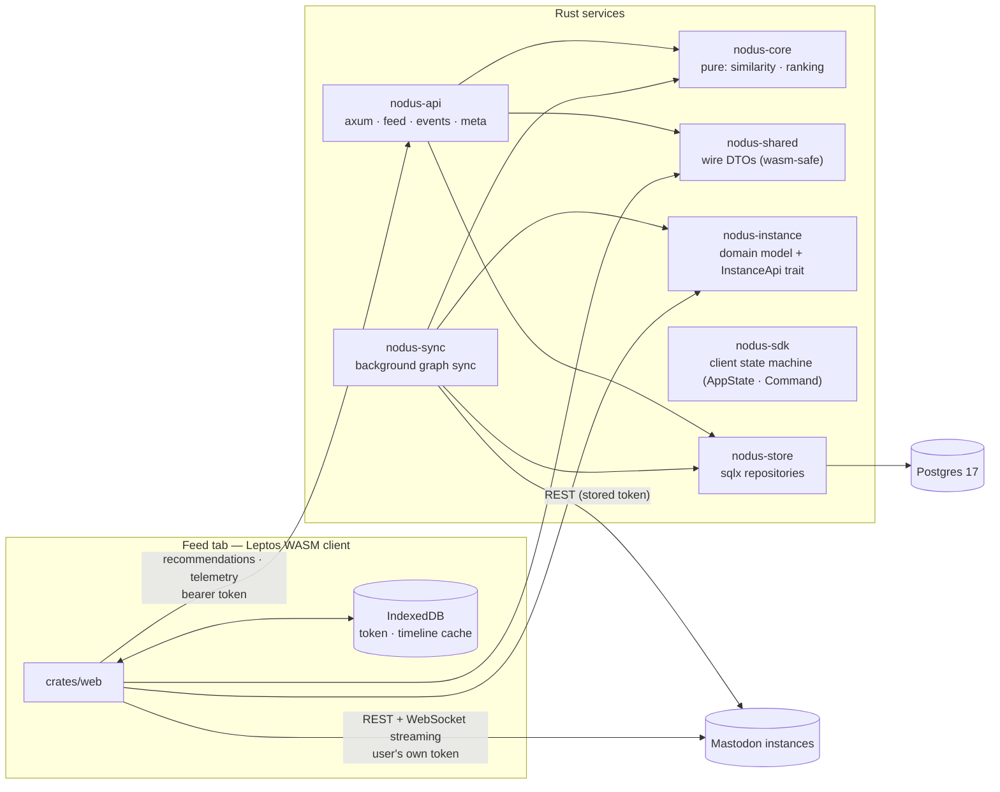

# 02 — Architecture

Status: draft · Last revised: 2026-11-06 (revision 4: SDK owns client state; superproject with submodules)

## Shape

A **client that talks to Mastodon directly** and a **recommendation service**
that syncs in the background and serves ranked candidates. One Postgres. No
message broker. Three repositories.



Two rules make this coherent:

1. **The browser is the client's data plane.** Timelines, threads, compose,
   notifications and streaming go straight from the WASM app to the instance
   the user belongs to. Our API is not a proxy — it would double our rate-limit
   exposure and add latency for no benefit.
2. **Our API is the discovery plane.** It owns the follow graph, similarity,
   ranking, recommendation snapshots and interaction telemetry. It never serves
   a home timeline.

## Repositories

```text
Nodus/
├── sdk/          nodus-shared, nodus-instance, nodus-sdk  (git repo)
├── backend/      core, store, ingest, api                        (git repo)
│   └── docs/     this document set
└── web/          the Leptos client                               (git repo)
    └── docs/     the client document set
```

The three projects are submodules of one superproject. `backend` and `web` both
depend on the SDK crates, and both are compiled for different targets (native vs
`wasm32`). Three consequences worth stating, because they are the reason this
split has costs:

- **The SDK owns client state, not just types.** Session, timelines, feed,
  streaming status and cache policy live in `nodus-sdk`; the web client
  renders that state and dispatches commands. Without this, pagination and
  cache-expiry rules would exist twice (browser and sync worker) and drift.
- **Pinned by gitlink, consumed by path.** The superproject records the exact
  commit of each submodule, and consumers depend on `path = "../sdk/crates/…"`.
  One commit therefore describes a known-good combination, and a cross-project
  change compiles before anything is pushed. Git-URL dependencies were rejected:
  they duplicate the sources, add a second source of pinning, and block the
  edit-and-build loop.
- **Additive-only within a minor.** The two sides deploy independently, so a
  change that removes or renames a field is a major bump and a coordinated
  release. See [08-sdk.md](08-sdk.md).

The SDK repository also runs a CI job that checks out `backend@main` and
`web@main` against the proposed SDK commit: it is the only place where both
consumers are guaranteed to compile together.

The devcontainer at the repository root mounts all three projects into one
container, which is the supported local setup.

## Crates

| Crate | Repo | Kind | Responsibility |
| --- | --- | --- | --- |
| `nodus-core` | backend | lib, pure, wasm-safe | domain types, similarity, candidate generation, scoring, diversity, reason formatting. No I/O, no clock, no async. |
| `nodus-shared` | sdk | lib, wasm-safe | wire DTOs shared by API and client (serde). The single source of truth for the HTTP contract. |
| `nodus-instance` | sdk | lib, native + wasm | Mastodon domain model plus `InstanceApi` (the operations as a trait). Transports are feature-gated: `reqwest` on native, `gloo-net`/`web-sys` on wasm. One surface, no duplicated endpoint definitions. |
| `nodus-sdk` | sdk | lib, wasm-safe | client state machine: `AppState`, `Command`, `Sdk<I, D, P, C>` over four ports (`InstanceApi`, `Discovery`, `Persistence`, `Clock`). No framework dependency, no I/O in `dispatch`. |
| `nodus-store` | backend | lib | the only crate that writes SQL: sqlx repositories, migrations. |
| `nodus-ingest` | backend | lib + `nodus-sync` bin | background graph sync, job queue, crawl frontier, rate limiter. |
| `nodus-api` | backend | bin | axum HTTP: recommendations, telemetry, token intake, health/metrics. |
| `nodus-web` | web | wasm bin | the Leptos client (the product UI). |

`core`, `shared` and `mastodon` compile to `wasm32-unknown-unknown`; if one of
them starts needing tokio or sqlx, something is in the wrong crate.

## Token and identity model

The client authenticates to Mastodon itself: dynamic client registration
(`POST /api/v1/apps`) from the browser, PKCE authorization, token kept in
**IndexedDB**. The token never passes through our server as a redirect — but the
user can grant us a **copy** for background sync:

```text
browser: register app → authorize (PKCE) → token in IndexedDB
        ↓ (explicit consent screen)
POST /api/v1/sync/token  (bearer: the same token)
        ↓
server: verify via /accounts/verify_credentials → upsert app_user →
        encrypt (XChaCha20-Poly1305) → store → enqueue P0 sync
```

Without that grant the client works fully and our API still ranks on demand
(using the bearer token it receives per request), but similarity only advances
while the client is open. That is a legitimate privacy-preserving mode; it is
just weaker.

Why server-side storage at all: the graph has to advance while the user is
asleep, and a follow list read every 24 h is what keeps candidates fresh.

**Consequence:** there are no server sessions and no cookie auth. See
[07-api.md](07-api.md) and the threat model in [09-privacy.md](09-privacy.md).

## The client

Leptos, client-side rendered (CSR), built with `trunk`, optimized with
`wasm-opt`. SSR is deliberately not used: the interesting data requires the
user's browser-held token, so server rendering could only produce an empty
shell, while adding a Rust web server to the critical path.

The client is a static bundle on a CDN, so it is a **different origin** from
this API: `WEB_ORIGINS` on the server and a strict CSP on the client are part of
the contract between the two deployments. Development uses `trunk serve` with a
proxy to the API. Client scope, data layer and performance budget live in
`web/docs/`.

## Data flow: feed request

1. Client sends `GET /api/v1/feed/accounts` with the bearer token.
2. API verifies/caches the token → `app_user` (10-minute TTL cache keyed by
   token hash, so a feed request is not an extra Mastodon round trip).
3. API loads candidates (`account_affinity`), ranks in `core`, applies diversity
   and fatigue, persists the recommendation snapshot, returns items with opaque
   `item_id`s and reasons.
4. Client renders, reports impressions/clicks back to `/api/v1/events`.

The client never recomputes ranking, so a stale client cannot produce
inconsistent results, and the server remains the single source of what was shown.

## Data flow: sync

| Tier | Job | Cadence | Cost |
| --- | --- | --- | --- |
| P0 | `sync_user` — following, favourites, bookmarks, notifications | on token intake, then daily | ~10 req/user |
| P1 | `expand_follows` — following lists of accounts followed by ≥ 2 users | hourly, capped | 1 req/account |
| P2 | `refresh_account` — metadata | 7-day TTL | 1 req/account |
| P3 | `fetch_statuses` — recent posts of top candidate authors | 6 h | 1 req/author |
| P4 | backlog | best effort | idle capacity |

Details and budget math in [04-ingestion.md](04-ingestion.md).

## Stack decisions

| Concern | Choice | Notes |
| --- | --- | --- |
| Async runtime | tokio (server only) | client is single-threaded wasm; no tokio in `web` |
| HTTP framework | axum | serves API + static WASM |
| DB access | sqlx, compile-checked SQL | analytical queries are SQL-shaped; D1 |
| Migrations | sqlx migrate, `migrations/*.sql` | never edited after merge |
| DB | Postgres 17 (`pgvector/pgvector:pg17`) | pgvector present, unused |
| Client | Leptos 0.8, CSR, trunk, wasm-opt | D5; `web` repo |
| Client data | `gloo-net` + `web-sys` WebSocket + IndexedDB | streaming and offline cache |
| API client (shared) | one crate, two transports | prevents the native/wasm endpoint drift |
| Errors (server) | `thiserror` + typed API error envelope | |
| Config | env vars → typed `Config` | [10-operations.md](10-operations.md) |
| Observability | `tracing` + Prometheus metrics | no PII, no tokens |

## Failure modes

| Failure | Behaviour |
| --- | --- |
| Instance 429/5xx during sync | backoff honouring `Retry-After`; per-host limiter |
| Token revoked | sync stops, user is told in-app, client keeps working with its own token until re-auth |
| Browser storage cleared | client re-authorizes; sync resumes; no data loss server-side |
| Worker down | feed serves stored data; `similarity_age_hours` grows; UI shows freshness |
| API down | client still renders timelines and compose (direct to Mastodon); only the Feed tab degrades, with an explicit banner |
| Malicious instance | responses are untrusted: HTML is sanitized before render, media is not proxied, CSP blocks inline script |
| XSS in client | token is in IndexedDB — mitigated by strict CSP, no third-party scripts, no `innerHTML` of untrusted content; see [09-privacy.md](09-privacy.md) |

## Deliberately absent

- No BFF/proxy for Mastodon traffic: the client talks to instances directly.
- No message queue: `job` table + `FOR UPDATE SKIP LOCKED`.
- No Redis, no session store.
- No SSR, no Node toolchain, no npm (Playwright is dev-only, in the `web` repo).
- No microservices: one API, one worker, one database.
- No shared runtime library beyond the SDK crates: `core` is backend-only.
